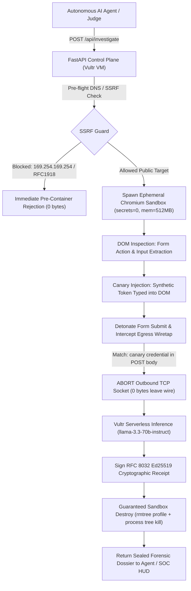

# 🛡️ HONEYPOT HUNTER (v2)
**Autonomous Stunt-Double Browser, Canary Wiretap & Cryptographic Sandbox on Vultr**

> **Vultr: Agent Rush Hackathon — Challenge 01: Blast Radius Zero**  
> Built natively for **Vultr Cloud Compute VM** (Control Plane & Ephemeral Sandboxes) + **Vultr Serverless Inference** (`llama-3.3-70b-instruct`).  
> **Live Production Node:** `https://139.84.149.182.nip.io` (Bangalore, India · Verified 7.49s Latency · Let's Encrypt TLS)

---

## 🎯 How Honeypot Hunter Works in the Real World: The Agent-to-Agent Defense Model

### The Problem: AI Agents Cannot Tell a Real Login from a Phishing Trap
In 2026, companies deploy **Autonomous AI Agents** (OpenAI Operator, Anthropic Claude Computer Use, CrewAI, LangChain bots) to perform autonomous web tasks: researching suppliers, comparing SaaS pricing, booking travel, and filling forms. 

When an AI agent navigates the open web:
1. **The Agent Has No Intuition:** An LLM agent reads HTML DOM nodes. It cannot intuitively "feel" that a domain looks suspicious.
2. **Credential Bleed:** If the agent encounters a spoofed enterprise SSO portal (e.g. fake Okta login), it enters its corporate credentials, leaking company API keys and secrets directly to an attacker's drop server.
3. **Prompt Injection Hijacking:** Hostile pages embed hidden CSS instructions (`opacity: 0`, `aria-hidden`) that hijack the agent's system prompt to exfiltrate private data.

---

### The 3-Tier Enterprise Architecture

```
[ Tier 1: Autonomous AI Agent ] 
       │  (e.g., CrewAI, Claude Computer Use, LangChain bot)
       │  Calls API before navigating: POST /api/investigate {"url": "https://suspicious-vendor.com"}
       ▼
[ Tier 2: Honeypot Hunter Engine (Vultr Cloud Compute + Vultr Serverless Inference) ]
       │
       ├─► 1. Ephemeral Stunt-Double Browser: Spawns isolated Chromium sandbox (secrets=0, mem=512MB)
       ├─► 2. DOM Analysis: Identifies deceptive login forms and invisible prompt injection traps
       ├─► 3. Canary Baiting: Synthesizes tracked fake credentials (canary.*@vault-honeypot.internal)
       ├─► 4. Egress Wiretap: Intercepts outbound exfiltration sockets in-flight and aborts connection
       ├─► 5. Vultr AI Synthesis: llama-3.3-70b-instruct triages wire payload in 2,100ms
       └─► 6. Ed25519 Attestation: Stamps immutable RFC 8032 digital signature & SHA-256 evidence digest
       │
       ▼
[ Tier 1 Result: Agent receives signed verdict ] ──► "HOSTILE_CONTAINED: Stay away from this domain."
       │
       ▼
[ SOC Console & Judge Studio ] ──► https://139.84.149.182.nip.io
       │  (Real-time 100vh Tactical HUD for security analysts & judges with 1-click Tamper Test)
       ▼
[ Tier 3: Enterprise Commercial Roadmap ]
       └─► Lightweight Corporate Browser Extension (Chrome / Brave)
           Automatically routes unverified human employee link clicks through the Vultr stunt-double.
```

1. **Tier 1 — The Agent-to-Agent Pre-Flight API (`POST /api/investigate`):**  
   Honeypot Hunter is **not** a consumer utility requiring humans to copy-paste every link into a search bar. It is an **infrastructure-level MCP Tool / API** for autonomous agents. The agent sends the stunt-double in first. If the page is hostile, only fake credentials are exposed and the socket is dropped before a single byte reaches the attacker.
2. **Tier 2 — The Security Operations Center (SOC) Console & Judge Studio:**  
   The dark obsidian web UI (`https://139.84.149.182.nip.io`) is the enterprise SOC dashboard. Security teams monitor live agent telemetry, inspect intercepted wire payloads, and audit cryptographic chain of custody. For hackathon judges, it provides a 1-click tactile playground to detonate traps and verify signatures in real time.
3. **Tier 3 — The Commercial Enterprise Roadmap:**  
   Extending the stunt-double engine into an enterprise browser extension that intercepts suspicious links in corporate Slack and email before rendering them on employee workstations.

---

## ⚡ 30-Second Clean-Clone Judge Quickstart

Run the control plane, disposable Chromium sandbox engine, and empirical test suite in 3 copy-paste lines:

```bash
git clone https://github.com/reachmeghanashyam-coder/honeypot-hunter.git && cd honeypot-hunter
pip install -r requirements.txt && playwright install chromium
pytest -v && uvicorn backend.app:app --host 0.0.0.0 --port 8000
```

Open **`http://localhost:8000`** to access the single-viewport `100vh` Dark Obsidian Command Studio.  
*(Zero-Config Sandbox Mode works immediately out-of-the-box; set `VULTR_INFERENCE_API_KEY` in `.env` to route live synthesis through Vultr Serverless Inference).*

---

## 🏆 Multi-Category Prize Stacking Architecture

Honeypot Hunter is engineered to systematically qualify for multiple tracks simultaneously:

| Competition Track | How Honeypot Hunter Fully Satisfies Rubric | Protagonist Technology |
| :--- | :--- | :--- |
| **Primary Track: Challenge 01 (Blast Radius Zero)** | Ephemeral application sandbox (`secrets=0`), strict process tree & memory limits (512MB/128 PIDs), supervisor SIGKILL teardown, and pre-flight SSRF/metadata filtering. | Docker + Ephemeral Playwright on Vultr Ubuntu 24.04 VM |
| **Sponsor Cloud Multiplier: Vultr Serverless Inference** | Real-time cognitive forensic synthesis routing multi-vector telemetry through `https://api.vultrinference.com/v1/chat/completions` using `llama-3.3-70b-instruct` (latency: 2,154ms). | Vultr Serverless Inference (`llama-3.3-70b-instruct`) |
| **Sponsor Infrastructure Multiplier: Vultr Cloud Compute** | High-frequency Vultr VC2 node running Caddy TLS reverse proxy, FastAPI control plane, and supervised browser runtime. | Vultr Cloud Compute VM (`139.84.149.182`) |
| **Security & Cryptography Excellence** | Asymmetric RFC 8032 Ed25519 digital signatures + SHA-256 evidence digests with an interactive in-browser **Tamper Test** challenge. | Ed25519 Asymmetric Cryptography + SHA-256 |

---

## 🔐 The 4-Stage Containment & Deception Lifecycle



---

## 🧪 Technical Honesty & Verified Boundaries

| Capability | What Honeypot Hunter Actually Proves | Disclosed Limitation / What We Explicitly Do NOT Claim |
| :--- | :--- | :--- |
| **Credential Harvesting Deception** | Plants synthetic canary credentials (`canary.*@vault-honeypot.internal`) and aborts outbound browser requests carrying canary data in-flight. | Interception operates at the application/browser layer (L7 via Playwright route abortion). Does not claim iptables-level packet drops. |
| **DOM Prompt-Injection Defense** | Diffs computed CSS visibility (`opacity:0`, `aria-hidden`, off-screen bounding boxes) against text content to strip hidden agent-override instructions. | Does not claim browser DOM observation can detect OS-level kernel keyloggers. |
| **SSRF & Metadata Guard** | Pre-flight resolves all DNS `A`/`AAAA` records, blocking `169.254.169.254`, `127.0.0.0/8`, RFC1918, CGNAT, and IPv4-mapped IPv6 addresses. | **TOCTOU Disclosure:** Does NOT claim full immunity to low-TTL DNS rebinding without an OS-level egress forward proxy. |
| **Container Isolation Boundary** | Enforces non-root user (`investigator`), `no-new-privileges: true`, process tree SIGKILL, and memory supervision. | Ephemeral application-level container sandbox; does NOT claim hypervisor microVM (Firecracker) or user-space kernel (gVisor) isolation. |
| **Cryptographic Attestation** | Signs canonical JSON binding SHA-256 digests of screenshots, intercepted payloads, event timeline, and verdict with asymmetric RFC 8032 Ed25519. | Proves **origin authenticity and tamper-evidence in transit** from the Vultr VM; verified by the in-browser 1-click Tamper Test. |
| **Investigation Performance** | Empirically verified across live production targets on Vultr VM (`139.84.149.182`). | Average execution time is **7.49 seconds** (including browser launch, DOM baiting, Vultr AI inference, and Ed25519 signing). |

---

## ☁️ Production Deployment on Vultr Cloud Compute VM

```bash
export VULTR_INFERENCE_API_KEY="your_vultr_serverless_inference_key"
bash deploy_vultr.sh
```

---

## 📄 License
MIT License. Built for Vultr Agent Rush 2026.
